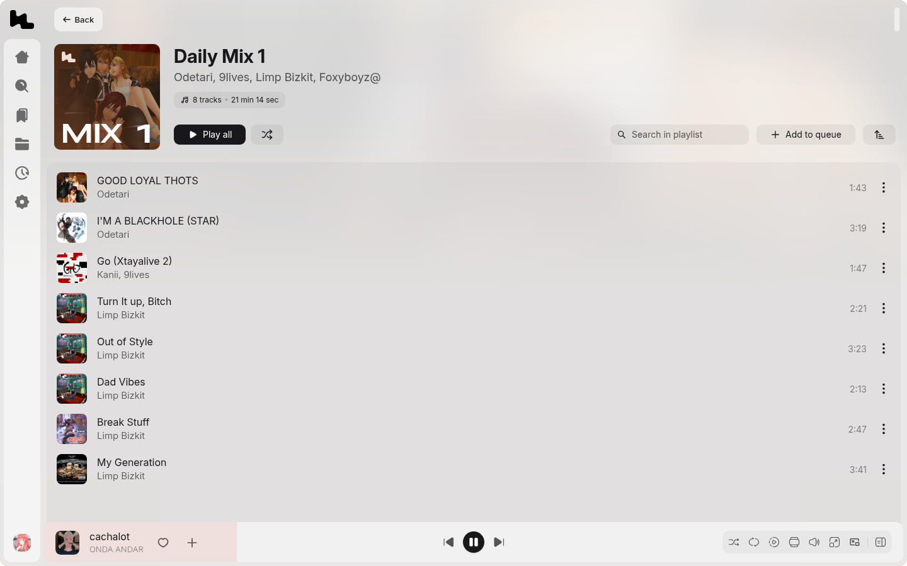
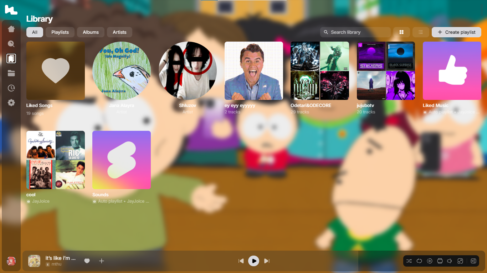
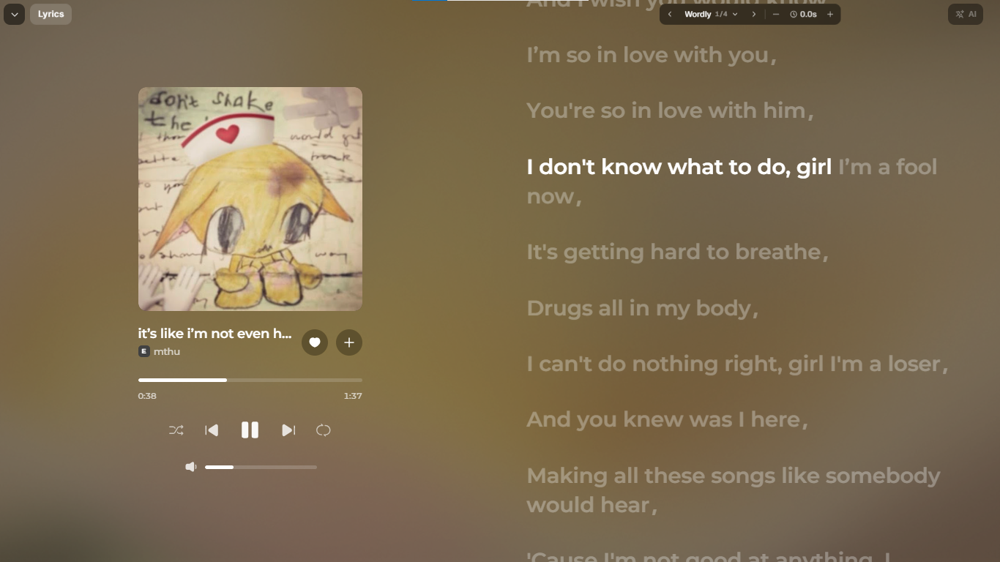

# Liner Website Port

**The website port of Liner — the modern music streaming player with syllable-synced lyrics and reactive dynamic visuals, running entirely in your browser.**

[](https://goodbyeworld42-ai.github.io/Liner-Website-Port/) [](#getting-started) [](#architecture) [](https://tryliner.fun) [](https://github.com/tryliner/desktop) [](./LICENSE)
<div align="center">



### [▶ Open the live port — liner-music.space-z.ai](https://liner-music.space-z.ai/#/)

### [▶ Visit the website — goodbyeworld42-ai.github.io/Liner-Website-Port](https://goodbyeworld42-ai.github.io/Liner-Website-Port/)

[About](#about) • [Screenshots](#screenshots) • [Features](#features) • [Architecture](#architecture) • [Getting Started](#getting-started) • [Building](#building) • [Docs](#docs) • [License](#license)

<br/>

</div>

---

## About

Liner Web is a **port**, not a client and not a wrapper. There is no Electron binary behind it, no webview pointed at a desktop build and no downloaded installer served up in a browser tab: the renderer has been rebuilt for the web, and the desktop layer it used to depend on has been replaced with web-native equivalents.

What actually changed:

- The Electron **main process** is gone → a Next.js shell hosts the built bundle and provides lightweight API relays.
- Filesystem and `local-tracks/` access is gone → storage lives in **IndexedDB**.
- Native IPC helpers are gone → the same playback and presence work runs through **`/api/*` relays** in the browser.
- Desktop packaging is gone → the SPA is served as static assets, openable from any modern browser.

The result is the same application — every screen, animation and audio engine — with nothing installed on your machine.

> [!NOTE]
> This is an unofficial, community-made port of the [Liner desktop app](https://github.com/tryliner/desktop). It is not affiliated with, endorsed by, or supported by the Liner team, and it is not the official desktop client.

> [!NOTE]
> Liner Web connects to the official Liner API backend for music catalog, streaming playback and synchronized lyrics, exactly as the desktop app does.

---

## Screenshots

**Library** — likes, playlists, saved albums and artists, plus auto-generated mixes.



**Lyrics** — syllable-synced lyrics with AI translation and a reactive WebGL background.



---

## Features

- **Full streaming player** — search, albums, artists, playlists, mixes, queue and library, the same as the desktop app
- **Syllable-synced lyrics** with AI translation, fullscreen view and reactive WebGL background
- **Mini player & overlay** — a compact always-visible player bar with full transport controls
- **Discord Rich Presence** — broadcasts what you're listening to straight from the browser, with cover art, artist badge and a live progress bar
- **Equalizer, speed & pitch** — the desktop audio engines, running on the Web Audio API
- **Local storage** — likes, playlists, play history and cached covers live in your browser, on your device
- **12 languages** — the same translation set as the desktop app
- **Keyboard shortcuts** — the full desktop shortcut set, browser-native

---

## Architecture

The SPA follows [Feature-Sliced Design](https://feature-sliced.design): imports only point down the layers (`app` → `widgets` → `features` → `entities` → `shared`). A thin Next.js shell serves the built bundle and hosts the browser-side relays that the desktop app used to handle natively.

```
Liner-Website-Port/
├── src/                     # Next.js App Router shell: routes & API relays
│   ├── app/
│   │   └── api/
│   │       ├── yt/          # Innertube proxy (WEB_REMIX playback pipeline)
│   │       ├── fetch/       # Generic upstream proxy (imports, oauth, fallbacks)
│   │       ├── discord/     # Discord REST relay for web Rich Presence
│   │       ├── discord-asset/ # Artwork upload for presence assets
│   │       └── …            # ai-translate, po-token, announcements, …
│   └── lib/                 # Proxy helpers shared by the relay routes
├── liner-app/               # The ported renderer (Vite + React)
│   ├── src/
│   │   ├── app/             # App shell, routes, providers, global styles
│   │   ├── widgets/         # Screen blocks: sidebar, header, player bar, fullscreen player
│   │   ├── features/        # player, lyrics, library, search, discord, settings, …
│   │   ├── entities/        # track, playlist, artist, user
│   │   ├── shared/          # API client, storage, UI kit, contracts, utilities
│   │   ├── languages/       # Translations for 12 languages
│   │   └── main.tsx         # Vite entry point
│   │   └── vite.config.ts
├── public/liner/            # Built SPA bundle served by the shell
├── prisma/                  # Database schema
├── scripts/                 # Build & deploy pipeline
└── docs/screenshots/        # Images used in this README
```

**Where the desktop layer went:**

| Desktop (Electron) | This port (web) |
| --- | --- |
| Main process windows & IPC | Browser tabs + Next.js shell |
| `local-tracks/` protocol | IndexedDB (`linerDb`) |
| `youtube/` playback helpers | `/api/yt` innertube relay |
| `discord.ts` Rich Presence (IPC) | Gateway presence client + `/api/discord` relay |
| `crypto.ts` / `signer.ts` (WASM) | In-browser WebAssembly signer |
| Electron packaging & auto-update | Static bundle loaded over HTTP |

---

## Getting Started

### Prerequisites

- **Node.js** `v22+`
- Any modern browser (Chrome, Edge, Firefox, Safari)

---

### Setup

```bash
git clone https://github.com/goodbyeworld42-ai/Liner-Website-Port.git
cd Liner-Website-Port

# the Next.js shell
npm install

# the ported renderer
npm install --prefix liner-app
```

---

### Running in Development

```bash
# Next.js shell with the API relays (serves on :3000)
npm run dev

# Vite dev server with hot reload for the renderer (serves on :5173)
npm run dev --prefix liner-app
```

In development the Vite server proxies `/api/*` to the Next.js shell, so the whole port works end to end with hot reload.

---

## Testing

```bash
# Renderer tests only (vitest)
npm run test --prefix liner-app

# Everything CI runs on a pull request: lint, format check, build, tests
npm run check --prefix liner-app
```

---

## Building

```bash
# Build the renderer and sync it into the shell (public/liner)
npm run build --prefix liner-app

# Build the Next.js shell (standalone output)
npm run build
```

The production server is a standalone Node process serving both the shell routes and the SPA bundle:

```bash
NODE_ENV=production node .next/standalone/server.js
```

Packages are placed in `.next/standalone/`. The deploy pipeline in `scripts/` chains the renderer build, bundle sync, Next build and server restart in one command.

---

## Docs

The shared documentation lives in the upstream repository and applies to this port:

- [Design guidelines](https://github.com/tryliner/desktop/blob/main/docs/DESIGN.md): tokens, glass surfaces, motion and building blocks
- [Storage](https://github.com/tryliner/desktop/blob/main/docs/STORAGE.md): where data lives on your device and what "Clear cache" removes
- [Privacy](https://github.com/tryliner/desktop/blob/main/docs/PRIVACY.md): everything the app sends off your device
- [Translations](https://github.com/tryliner/desktop/blob/main/docs/I18N.md): adding strings, plurals and languages
- [FAQ](https://github.com/tryliner/desktop/blob/main/docs/FAQ.md): answers to the most common problems

---

## Contributing

This port follows the upstream project. Bug fixes, small features, translations and docs fixes are welcome — read [CONTRIBUTING.md](https://github.com/tryliner/desktop/blob/main/CONTRIBUTING.md) and [AGENTS.md](https://github.com/tryliner/desktop/blob/main/AGENTS.md) before you open a pull request, and report bugs in the [upstream issue tracker](https://github.com/tryliner/desktop/issues/new/choose). Questions and ideas go to [Discussions](https://github.com/tryliner/desktop/discussions), security issues to [SECURITY.md](https://github.com/tryliner/desktop/blob/main/SECURITY.md).

---

## Special Thanks

- [`@braccato/core`](https://github.com/better-lyrics/braccato) & `@braccato/parsers` — Synced lyrics components and format parsers.
- [Kawarp](https://github.com/better-lyrics/kawarp) — WebGL background shader the fullscreen background is based on.
- [Solar Icons](https://solar-icons.com) & [MingCute Icons](https://www.mingcute.com) — Icon collections.
- The [Liner](https://github.com/tryliner/desktop) team — the app this port is built from.

---
## who is JayJoice?

JayJoice is a 15 year old boy who codes, port things, loves music and etc.
as he learns haxe, python, lua, typescript, javascript and much all. (coding isnt easy btw)
He is a FNF Modder and loves porting psych engine mods into v slice (base game)

**How did Liner inspired him to make a website port?**

People must need what they need, thats why JayJoice exist to fulfill people's request/dream
they make a suggestion in the liner discord (discord.gg/liner) he added those. things get boring? dm him on discord. tell him what you want to be added in liner website port, he adds them. 

**How do i add him/contact him?**
Below is his contact info:
Discord: cryptojay.eth, thearchyexpunged
Gamebanana: https://gamebanana.com/members/4869559
Gmail: seekfromohio@gmail.com


## License

Liner Web is a port of Liner and is distributed under the same **Liner Source-Available & Non-Commercial Contribution License** as the [desktop app](https://github.com/tryliner/desktop).

- **Allowed**: Personal non-commercial usage, local builds, and upstream contributions.
- **Prohibited**: Commercial distribution, public competing forks, or extracting core algorithms for third-party products.

See [LICENSE](./LICENSE) for details.
